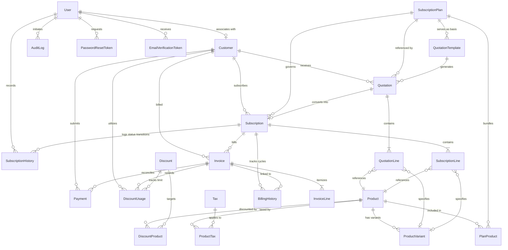

# Brightloop Subscription Management System - Database Design & ER Specification

## 1. Overview & Data Integrity Principles

The Brightloop relational database is architected on **PostgreSQL** using **Prisma ORM**. It is strictly normalized to 3NF, enforces referential integrity across all relationships, and implements immutable historical snapshots for all financial records (Quotations, Invoices, Payments, Tax configurations).

### Key Directives:
1. **Monetary Precision:** All currency amounts use PostgreSQL `NUMERIC(15, 2)` (or `NUMERIC(15, 4)` for tax/discount percentages). **Zero floating-point types (`FLOAT`, `DOUBLE PRECISION`) are used.**
2. **Deletion Policies:** Financial transactions (Invoices, Payments, BillingHistories) and audit logs use `ON DELETE RESTRICT`. Customer and Product soft-deletion is enforced via `status = 'INACTIVE'`.
3. **Idempotency:** Unique composite indexes enforce zero duplicate billing cycles for any subscription (`subscriptionId + billingPeriodStart`).

---

## 2. Entity-Relationship (ER) Diagram

---

## 3. Data Dictionary & Detailed Entity Specifications

### 3.1 Identity & Authentication

#### 1. `User`
| Field | Type | Modifiers | Description |
| :--- | :--- | :--- | :--- |
| `id` | UUID | PK, default `gen_random_uuid()` | Primary identifier |
| `email` | VARCHAR(255) | UNIQUE, NOT NULL | Account email |
| `passwordHash` | VARCHAR(255) | NOT NULL | Salted bcrypt hash |
| `name` | VARCHAR(255) | NOT NULL | Full name |
| `role` | RoleEnum | NOT NULL, default `CUSTOMER` | `ADMIN`, `STAFF`, `CUSTOMER` |
| `status` | UserStatusEnum| NOT NULL, default `ACTIVE` | `ACTIVE`, `INACTIVE`, `SUSPENDED` |
| `emailVerified`| TIMESTAMP | NULLABLE | Verification timestamp |
| `createdAt` | TIMESTAMP | NOT NULL, default `NOW()` | Record creation time |
| `updatedAt` | TIMESTAMP | NOT NULL | Record update time |

#### 2. `PasswordResetToken` & `EmailVerificationToken`
- Fields: `id`, `userId` (FK to User), `tokenHash` (UNIQUE), `expiresAt`, `usedAt`, `createdAt`.
- Tokens are one-time use, time-bounded (e.g. 1 hour expiration).

#### 3. `AuditLog`
- Fields: `id`, `userId` (FK to User, nullable), `action` (e.g. `INVOICE_CONFIRM`, `SUBSCRIPTION_PAUSE`), `entityType`, `entityId`, `oldValues` (JSONB), `newValues` (JSONB), `ipAddress`, `userAgent`, `createdAt`.

---

### 3.2 Customer Management

#### 4. `Customer`
| Field | Type | Modifiers | Description |
| :--- | :--- | :--- | :--- |
| `id` | UUID | PK, default `gen_random_uuid()` | Primary identifier |
| `userId` | UUID | UNIQUE, NULLABLE, FK `User` | Linked portal account |
| `customerNumber` | VARCHAR(50) | UNIQUE, NOT NULL | E.g. `CUST-2026-0001` |
| `name` | VARCHAR(255) | NOT NULL | Customer contact name |
| `email` | VARCHAR(255) | INDEXED, NOT NULL | Primary billing email |
| `phone` | VARCHAR(50) | NULLABLE | Phone number |
| `companyName` | VARCHAR(255) | NULLABLE | Business or organization |
| `billingAddress` | JSONB | NOT NULL | Street, city, state, postalCode, country |
| `taxId` | VARCHAR(100) | NULLABLE | GSTIN / VAT / EIN |
| `status` | CustomerStatus | NOT NULL, default `ACTIVE` | `ACTIVE`, `INACTIVE` |
| `registrationDate` | DATE | NOT NULL, default `CURRENT_DATE` | Onboarding date |
| `createdAt` | TIMESTAMP | NOT NULL, default `NOW()` | Creation timestamp |
| `updatedAt` | TIMESTAMP | NOT NULL | Last update timestamp |

---

### 3.3 Catalog & Tax Architecture

#### 5. `Product`
- Fields: `id`, `productCode` (UNIQUE), `name`, `productType` (`SERVICE`, `SOFTWARE_LICENSE`, `ADDON`, `HARDWARE`), `salesPrice` (`NUMERIC(15, 2)`), `costPrice` (`NUMERIC(15, 2)`), `description`, `notes`, `status` (`ACTIVE`, `INACTIVE`), `createdAt`, `updatedAt`.

#### 6. `ProductVariant`
- Fields: `id`, `productId` (FK `Product`), `variantName` (e.g. `Standard`, `Odoo Edition`, `SAP Enterprise`), `additionalPrice` (`NUMERIC(15, 2)`), `sku` (UNIQUE), `status` (`ACTIVE`, `INACTIVE`), `createdAt`, `updatedAt`.
- Note: Effective Price = `Product.salesPrice + ProductVariant.additionalPrice`.

#### 7. `Tax` & `ProductTax`
- `Tax`: `id`, `taxCode` (e.g. `GST-18`), `name` (e.g. `Goods & Services Tax 18%`), `percentage` (`NUMERIC(5, 2)`), `taxType` (`INCLUSIVE`, `EXCLUSIVE`), `startDate`, `endDate`, `status` (`ACTIVE`, `INACTIVE`).
- `ProductTax`: Join entity between `Product` and `Tax`.

#### 8. `SubscriptionPlan` & `PlanProduct`
- `SubscriptionPlan`: `id`, `planCode` (UNIQUE), `name`, `description`, `subscriptionPrice` (`NUMERIC(15, 2)`), `billingFrequency` (`DAILY`, `WEEKLY`, `MONTHLY`, `YEARLY`), `minQuantity` (INT default 1), `availableFrom`, `availableUntil`, `autoCloseEnabled` (BOOL), `earlyClosureAllowed` (BOOL), `pauseAllowed` (BOOL), `renewalAllowed` (BOOL), `status` (`ACTIVE`, `ARCHIVED`).
- `PlanProduct`: Connects products bundled by default into the plan with default quantities.

---

### 3.4 Quotations & Templates

#### 9. `QuotationTemplate`
- Fields: `id`, `templateCode` (UNIQUE), `name`, `description`, `planId` (FK `SubscriptionPlan`), `paymentTerms` (e.g. `NET_15`, `NET_30`, `IMMEDIATE`), `validityDurationDays` (default 30), `status`, `createdAt`, `updatedAt`.

#### 10. `Quotation` & `QuotationLine`
- `Quotation`: `id`, `quotationNumber` (UNIQUE), `customerId` (FK `Customer`), `templateId` (FK `QuotationTemplate`, nullable), `planId` (FK `SubscriptionPlan`), `status` (`DRAFT`, `QUOTATION`, `CONFIRMED`, `EXPIRED`, `CANCELLED`), `subtotal`, `taxAmount`, `discountAmount`, `totalAmount`, `paymentTerms`, `expiryDate`, `confirmedAt`, `convertedSubscriptionId`, `createdAt`, `updatedAt`.
- `QuotationLine`: `id`, `quotationId` (FK `Quotation`), `productId` (FK `Product`), `variantId` (FK `ProductVariant`, nullable), `quantity` (INT), `unitPrice` (`NUMERIC(15, 2)`), `taxRate` (`NUMERIC(5, 2)`), `taxAmount` (`NUMERIC(15, 2)`), `discountAmount` (`NUMERIC(15, 2)`), `subtotal` (`NUMERIC(15, 2)`), `total` (`NUMERIC(15, 2)`).

---

### 3.5 Subscriptions & History

#### 11. `Subscription` & `SubscriptionLine`
- `Subscription`: `id`, `subscriptionNumber` (UNIQUE, e.g. `SUB-2026-0001`), `customerId` (FK `Customer`), `planId` (FK `SubscriptionPlan`), `quotationId` (FK `Quotation`, nullable), `status` (`DRAFT`, `QUOTATION`, `CONFIRMED`, `ACTIVE`, `PAUSED`, `CLOSED`, `EXPIRED`), `billingFrequency` (`DAILY`, `WEEKLY`, `MONTHLY`, `YEARLY`), `paymentTerms`, `startDate`, `expiryDate`, `nextBillingDate`, `lastBilledDate`, `autoRenew` (BOOL), `pausedAt`, `closedAt`, `cancellationReason`, `createdAt`, `updatedAt`.
- `SubscriptionLine`: Mirrors lines accepted from quotation or configured on subscription creation.
- `SubscriptionHistory`: `id`, `subscriptionId` (FK `Subscription`), `previousStatus`, `newStatus`, `action`, `performedByUserId`, `note`, `createdAt`.

---

### 3.6 Invoices & Historical Snapshots

#### 12. `Invoice` & `InvoiceLine`
- `Invoice`: `id`, `invoiceNumber` (UNIQUE, e.g. `INV-2026-0001`), `customerId` (FK `Customer`), `subscriptionId` (FK `Subscription`, nullable), `billingPeriodStart` (DATE), `billingPeriodEnd` (DATE), `invoiceDate` (DATE), `dueDate` (DATE), `subtotal`, `taxAmount`, `discountAmount`, `totalAmount`, `paidAmount` (default 0.00), `outstandingAmount`, `status` (`DRAFT`, `CONFIRMED`, `PAID`, `CANCELLED`, `OVERDUE`), `customerSnapshot` (JSONB storing name, company, taxId, address at invoice issuance), `createdAt`, `updatedAt`.
- `InvoiceLine`: `id`, `invoiceId` (FK `Invoice`), `productId`, `variantId`, `productName` (snapshot), `variantName` (snapshot), `quantity`, `unitPrice` (`NUMERIC(15, 2)`), `taxRate` (`NUMERIC(5, 2)`), `taxAmount`, `discountAmount`, `subtotal`, `total`.

---

### 3.7 Discounts & Payments

#### 13. `Discount`, `DiscountProduct`, `DiscountUsage`
- `Discount`: `id`, `discountCode` (UNIQUE), `name`, `discountType` (`FIXED_AMOUNT`, `PERCENTAGE`), `discountValue` (`NUMERIC(15, 2)`), `minPurchaseAmount` (`NUMERIC(15, 2)`), `minQuantity` (INT), `startDate`, `endDate`, `maxUsageCount` (INT), `currentUsageCount` (INT default 0), `status` (`ACTIVE`, `EXPIRED`, `DISABLED`).
- `DiscountProduct`: Junction table for product-specific discounts.
- `DiscountUsage`: Tracks every redemption against `customerId`, `invoiceId`, and `appliedAmount`.

#### 14. `Payment`
- Fields: `id`, `paymentNumber` (UNIQUE, e.g. `PAY-2026-0001`), `invoiceId` (FK `Invoice`), `customerId` (FK `Customer`), `paymentMethod` (`CASH`, `BANK_TRANSFER`, `UPI`, `CREDIT_CARD`, `DEBIT_CARD`, `OTHER`), `amount` (`NUMERIC(15, 2)`), `paymentDate` (TIMESTAMP), `transactionRef`, `notes`, `status` (`PENDING`, `SUCCESS`, `FAILED`, `REFUNDED`), `recordedByUserId`, `createdAt`, `updatedAt`.
- Note: Multiple payments per invoice supported. An invoice transitions to `PAID` if and only if `outstandingAmount == 0.00`. Overpayment beyond outstanding balance is strictly rejected.

---

### 3.8 Billing Engine Infrastructure

#### 15. `BillingHistory` & `BillingJob`
- `BillingHistory`: `id`, `subscriptionId` (FK `Subscription`), `invoiceId` (FK `Invoice`, nullable), `billingPeriodStart` (DATE), `billingPeriodEnd` (DATE), `scheduledDate` (DATE), `executedDate` (TIMESTAMP), `status` (`SUCCESS`, `FAILED`, `SKIPPED`), `attemptCount` (INT), `failureReason` (TEXT), `createdAt`.
- `BillingJob`: `id`, `jobId` (BullMQ job ID), `jobType`, `status`, `payload` (JSONB), `executedAt`, `completedAt`, `errorLog`, `createdAt`.
- **Constraint:** `UNIQUE(subscriptionId, billingPeriodStart)` ensures duplicate invoices cannot be generated even across concurrent job runs or network retries.

---

## 4. Database Indexing Strategy

1. `Customer(email)`, `Customer(customerNumber)`, `Customer(status)`
2. `Product(productCode)`, `Product(status)`
3. `SubscriptionPlan(planCode)`, `SubscriptionPlan(status)`
4. `Quotation(quotationNumber)`, `Quotation(customerId)`, `Quotation(status)`
5. `Subscription(subscriptionNumber)`, `Subscription(customerId)`, `Subscription(status)`, `Subscription(nextBillingDate)`
6. `Invoice(invoiceNumber)`, `Invoice(customerId)`, `Invoice(subscriptionId)`, `Invoice(status)`, `Invoice(dueDate)`
7. `Payment(paymentNumber)`, `Payment(invoiceId)`, `Payment(paymentDate)`
8. Composite: `BillingHistory(subscriptionId, billingPeriodStart)` (UNIQUE)
9. Composite: `DiscountUsage(discountId, invoiceId)`
